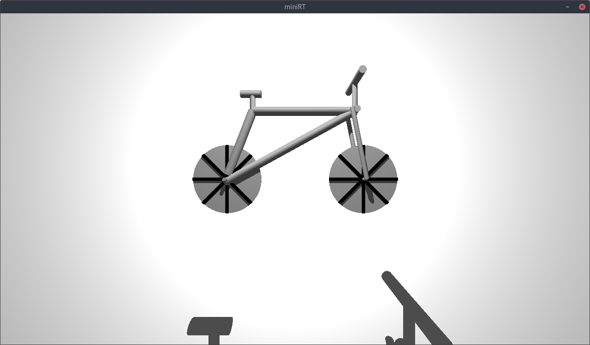
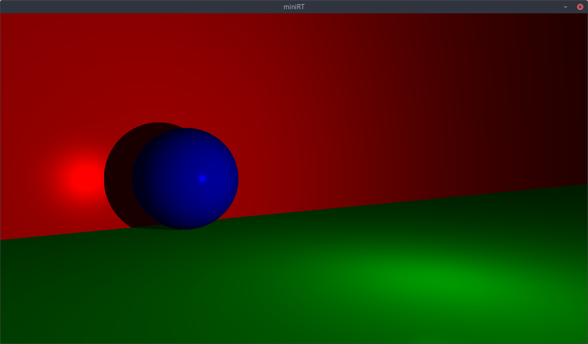
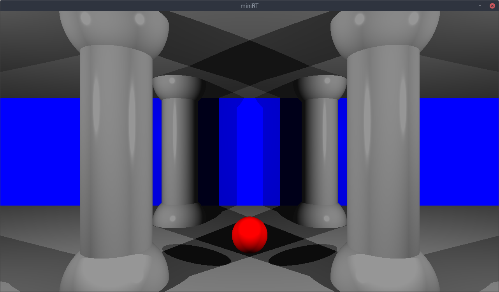
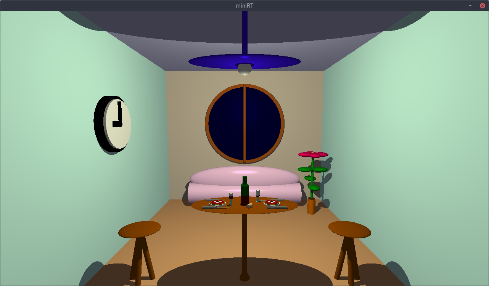

# MiniRT

A small ray tracing engine written in C. Part of the 42 school curriculum.

## Overview

MiniRT renders 3D scenes using ray tracing. You define scenes in `.rt` files with objects, lights, and camera settings, and the engine displays the result in real-time.

## Supported Objects

- **Spheres** (`sp`)
- **Planes** (`pl`)
- **Cylinders** (`cy`) with caps
- **Ellipsoids** (`el`)

## Features

- Ray tracing with hard shadows
- Multiple point lights (multilight)
- Ambient lighting
- Specular reflection
- Adjustable camera FOV (0-180°)
- Real-time camera movement and rotation

## Building

```bash
make
```

## Running

```bash
./miniRT <scene.rt>
```

## Controls

- `ESC` - Exit
- `W`/`S` - Move forward/backward
- `A`/`D` - Strafe left/right
- `R`/`F` - Move up/down

## Scene Format

### Camera
```
C <x,y,z> <dx,dy,dz> <fov>
```

### Lights
```
A <intensity> <r,g,b>          # Ambient
L <x,y,z> <intensity> <r,g,b>  # Point light (multiple supported)
```

### Objects
```
sp <x,y,z> <radius> <r,g,b>
pl <x,y,z> <nx,ny,nz> <r,g,b>
cy <x,y,z> <nx,ny,nz> <radius> <height> <r,g,b>
el <x,y,z> <sx,sy,sz> <r,g,b>
```

## Requirements

- MLX42 (graphics library)
- GCC
- Make

## Example of rendering

#### Bicycle map


#### Plane map


#### Temple map


#### Room map
